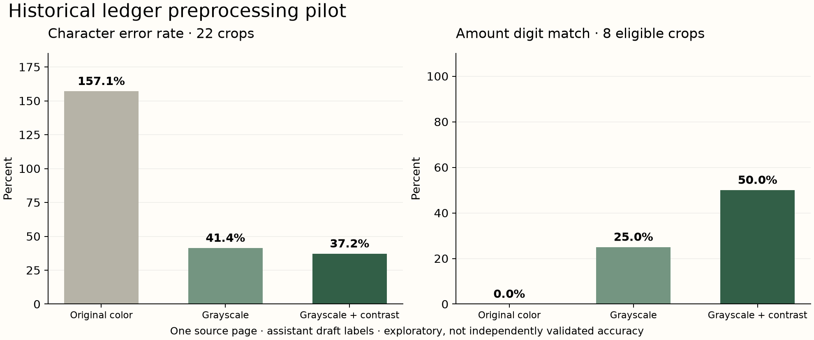

# Ledger HTR

Historical ledger images contain cursive names, monetary columns, abbreviations, and ditto marks. A plausible transcription can still alter a financial value. Ledger HTR helps a researcher inspect source images, review reference transcriptions, and measure those failures before using extracted data.

The current study runs three preprocessing variants of Microsoft's TrOCR-small on 22 source-linked crops from a real Brown Brothers ledger page. It includes a local reference-review app, strict evaluation, pinned model provenance, and preserved outputs. This is an independent portfolio study; it is not affiliated with the NYU/NYPL project.



**Study status:** working one-page pilot. Reference labels are assistant drafts and have not received independent human review. All reported ledger scores are exploratory. There is no held-out historical evaluation set yet. Transkribus full-page work is tracked separately in [the research note](docs/research-note.md).

## Run locally

Requires Python 3.12+; tested with Python 3.12 on macOS ARM64, CPU inference. Source images and model weights are downloaded separately and excluded from Git.

```bash
python3 -m venv .venv
source .venv/bin/activate
python -m pip install -r requirements.lock.txt
python -m ledger_htr.cli fetch
python -m ledger_htr.cli crop
python -m ledger_htr.cli serve --port 18765
```

Open [the local review app](http://127.0.0.1:18765). Inspect the crop against its source, correct the transcription, enter reviewer attribution, and check the review flag only after verifying the reading. Mark unresolved text as uncertain. Model predictions are hidden initially to reduce anchoring. Stop the server with Ctrl-C.

Reviewed edits persist in `data/references.local.jsonl`, which is excluded from Git. The original draft references remain unchanged. Restarting the server restores saved edits. Concurrent stale edits are rejected rather than overwriting newer work.

## Reproduce the experiment

```bash
python -m ledger_htr.cli download-model
python -m ledger_htr.cli infer --variant raw --output output/predictions/trocr-raw.jsonl
python -m ledger_htr.cli infer --variant grayscale --output output/predictions/trocr-grayscale.jsonl
python -m ledger_htr.cli infer --variant contrast --output output/predictions/trocr-contrast.jsonl

# Explicit opt-in is required to compare against unreviewed draft labels.
python -m ledger_htr.cli evaluate --predictions output/predictions/trocr-raw.jsonl --split pilot --include-unreviewed --output output/reports/trocr-raw.json
python -m ledger_htr.cli evaluate --predictions output/predictions/trocr-grayscale.jsonl --split pilot --include-unreviewed --output output/reports/trocr-grayscale.json
python -m ledger_htr.cli evaluate --predictions output/predictions/trocr-contrast.jsonl --split pilot --include-unreviewed --output output/reports/trocr-contrast.json
python scripts/render_results.py
```

For a reviewed comparison, pass `--references data/references.local.jsonl` and omit `--include-unreviewed`. Unreviewed or uncertain records are excluded by default. A run with no eligible references fails. The default split is `test`, so using this pilot requires an explicit `--split pilot`.

TrOCR is a **line recognizer**, not a page/table extractor. Crop coordinates are selected manually. The original-color, grayscale, and grayscale-plus-autocontrast variants share the same crop boundaries, model revision, and greedy decoding. See [the protocol](docs/protocol.md) for what is and is not measured.

## Actual pilot observations

| Variant | Character error rate | Word error rate | Exact crop match | Amount digit match |
|---|---:|---:|---:|---:|
| Original color | 157.1% | 127.1% | 0/22 | 0/8 |
| Grayscale | 41.4% | 89.6% | 0/22 | 2/8 |
| Grayscale + autocontrast | 37.2% | 91.7% | 0/22 | 4/8 |

These values compare predictions against **unreviewed draft references on one selected page**. They are not validated model accuracy or evidence of generalization. Edit-distance error rates can exceed 100% when inserted text outnumbers reference characters. Amount digit match removes non-digit characters from the prediction and applies only to fully numeric, two-part reference amounts; it does not establish correct currency, decimal placement, or ledger interpretation. Ditto-mark crops are excluded from this component metric.

Contrast improved character error rate relative to grayscale alone but slightly worsened word error rate. None of the crops matched exactly under the declared case/punctuation convention. That tradeoff motivates source review and field-level validation rather than trusting a single aggregate score.

A one-sample setup check on a published IAM test line produced 3.2% character error under both original and contrast inputs. It verifies a functioning inference path; it is not an IAM benchmark. Raw ledger predictions, per-crop errors, and that check are retained under `output/`.

## Transkribus workflow

The completed full-page export contains 4 regions and 97 lines from The English Eagle (exported model ID 53042). Source-linked layout/text are retained in `output/transkribus/`. Re-import the local archive with:

```bash
python -m ledger_htr.cli import-page --archive output/external/transkribus-page.zip --page-id nypl-57733030 --model-name "The English Eagle"
```

The original export is excluded from Git because it contains account metadata. The adapter retains only research fields, checks dimensions, and preserves line/region reading order. Upload identity is an attestation, not a hash verified by Transkribus.


Use the same crop images for a direct recognition comparison. Upload the PNGs in `data/crops/`, select a suitable English handwriting model, and export each transcription as UTF-8 text. Name the files with the corresponding crop ID, such as `nypl-57733030-amount01.txt`. Keep exports in a dedicated directory; unrelated filenames are rejected.

```bash
python -m ledger_htr.cli import-transkribus --directory output/external/crop-text --model-name "The English Eagle" --output output/predictions/transkribus.jsonl
python -m ledger_htr.cli evaluate --predictions output/predictions/transkribus.jsonl --split pilot --include-unreviewed --output output/reports/transkribus.json
```

Missing crop outputs are penalized, not silently dropped. This importer has fixture tests; real matched-crop Transkribus exports are not yet measured. Full-page exports test segmentation as well as recognition and must remain separate from the manually cropped experiment. Record the provider model name, visible version/ID where available, input hashes, and processing/export settings; a hosted provider may not expose a reproducible model revision.

## Data stewardship and validation

- A source manifest retains NYPL identifiers, source/context URLs, SHA-256, dimensions, and attribution. Changed source bytes fail verification.
- Each crop retains its page identity, pixel coordinates, source hash, crop hash, label status, and split.
- Model files are tied to a pinned public revision and verified before inference.
- Reports retain reference/prediction file hashes, micro-averaged edit counts, coverage, excluded-label counts, per-page and per-field summaries.
- Evaluation rejects duplicate/unknown prediction IDs and pages assigned to multiple splits. Missing outputs count as deletions. Case, punctuation, and digits are retained; only Unicode NFC and whitespace normalization are applied.
- The local app binds to loopback, serves only named source/crop routes, writes atomically, and rejects stale edits and cross-origin writes.

```bash
python -m pytest -q
```

Tests use explicitly synthetic fixtures. They cover metric arithmetic, insertion-heavy outputs, missing predictions, reference eligibility, page leakage, crop integrity, export mapping, saved-edit persistence, and stale-write rejection. See [validation evidence](docs/validation.md) for executed checks and remaining research work.

## Source and limitations

From The New York Public Library. The pilot image is NYPL image **57733030**, referenced by the [NYU project's public illustration](https://newyorkscapes.org/brownbrothers/index.html). The image visibly reads New Orleans, February 1844; that observation is not independently verified catalog dating. The source image service and retrieval hashes are recorded in `data/source-manifest.json`.

Manual crop selection and draft labels limit this study. The page was used to inspect errors and choose experiments, so it must remain a pilot/development page. Before claiming historical recognition accuracy, add human-reviewed labels and separate pages used only for final evaluation. Expanding across handwriting and layout styles requires a sampling plan. The project does not infer missing financial values, silently expand ditto marks, or claim end-to-end table extraction.
